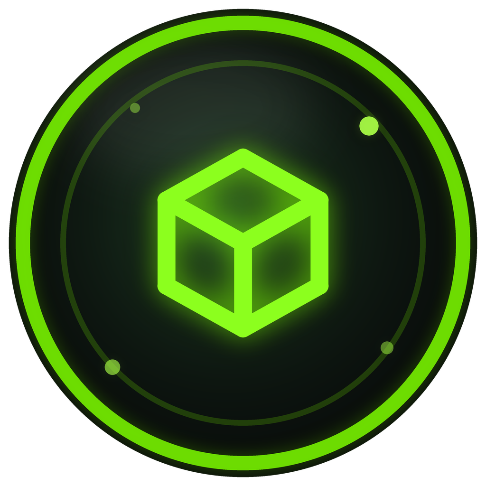

<div align="center">



# Bedrock Manager

**Import and manage Minecraft Bedrock add-ons, worlds and skins easily.**
**استورد وأدِر إضافات وعوالم وسكنات ماين كرافت بيدروك بسهولة.**

[English](#english) · [العربية](#العربية)

</div>

---

## English

Stop wrestling with folders and file managers. Bedrock Manager checks your add-on, packs it, and hands it straight to Minecraft.

### Features

- 📦 **Import everything:** resource packs, behavior packs, worlds, skin packs, and ready `.mcpack` / `.mcworld` / `.mcaddon` / `.mctemplate` files
- 📥 **Import from anywhere:** appears in the Android share sheet and "Open with", even when the app is closed
- 🗂️ **Multi-import:** select many files or folders and install them in one go
- ✅ **Check before installing:** detects corrupted ZIPs, missing `manifest.json` and duplicates (same UUID and version). It only warns you, and you can ignore it
- 📁 **Built-in file browser:** sorted by last modified (remembered), one-tap select on valid packs, or switch to your phone's file manager any time
- 📚 **Library:** search, filters, favorites, sorting, multi-select, and pack details (name, description, UUID, version, type, icon)
- 🪶 **Light by design:** your files are **not copied** into the app. The library only remembers where they are
- 🎮 **Game Files:** get your worlds, add-ons and skins out of Minecraft and save them anywhere (see limits below)
- 🕘 **History** with selective delete
- 🌍 **Arabic (RTL) and English**
- 🎨 Glowing dark design, sounds and smooth animations (with a Lite mode for older phones)
- 🔒 **No internet permission, no ads, no tracking**

### Requirements

Android 7.0 (API 24) or newer.

### Install

1. Go to the **[Releases page](https://github.com/BedrockManager/BedrockManager/releases)** and download the latest `.apk`.
2. Open it and allow installing from your browser or file manager if Android asks.
3. Open Bedrock Manager and tap **+**.

> ⚠️ **Only download from this official page.** Copies from other websites, chat groups or re-uploads may be modified and could contain unwanted or harmful software.

### Verify your download

Official builds are signed with this certificate. In the app, open **Settings → Verify app integrity** and compare the fingerprint:

```
SHA-256: E2:CB:83:C1:46:DA:C7:2C:DE:8B:4C:87:FD:BE:72:63:02:74:3C:DB:2B:0F:43:FE:CB:21:B1:2F:EF:4A:84:A1
```

Official builds check their own signature. If it does not match, the app refuses to run and closes.

### Game Files: what is possible

Android blocks apps from reading `Android/data`, where Minecraft keeps its data:

| Android | Direct access to Minecraft's folder |
|---|---|
| 7 – 10 | ✅ Works |
| 11 – 12 | ⚠️ Usually blocked, you can try granting access |
| 13 and newer | ❌ Blocked for every app |

On every version you can use **Export World** inside Minecraft and choose Bedrock Manager from the share list. The app then saves the file in any folder you pick.

### Permissions

| Permission | Why |
|---|---|
| All files access (Android 11+) / Read storage (Android 7–10) | Only for the built-in file browser. You can turn it off in Settings and use your phone's file manager instead |

There is **no internet permission**. The app works fully offline.

### Build from source

1. Open the project in Android Studio (or CodeAssist).
2. Edit `Config.java`: set `OFFICIAL_CERT_SHA256` to the fingerprint of **your** signing key.
3. Build, then sign the APK with your own key.

### Support

Use **Settings → Report a problem** or write to `supportbedrockmanager@gmail.com`.

### Disclaimer

Use the app at your own risk. The developer is not responsible for data loss, damaged worlds or any problem on your phone caused by wrong use, modified copies or downloads from unofficial places. Always back up your worlds first.

Bedrock Manager is **not affiliated with Mojang, Microsoft or any other party**. Minecraft is a trademark of Mojang AB.

Developed by **Demon Emperor**, an Arab developer, with the help of Claude (Anthropic's AI assistant).

---

<div dir="rtl">

## العربية

وفّر على نفسك التنقل بين المجلدات ومدراء الملفات. Bedrock Manager يفحص إضافتك ويجهزها ويسلّمها لماين كرافت مباشرة.

### المميزات

- 📦 **استيراد كل شيء:** حزم الموارد والسلوك والعوالم والسكنات، أو ملفات `.mcpack` و`.mcworld` و`.mcaddon` و`.mctemplate` الجاهزة
- 📥 **من أي مكان:** يظهر في قائمة المشاركة وفي "فتح بواسطة" حتى لو كان التطبيق مغلقاً
- 🗂️ **استيراد متعدد:** حدّد عدة ملفات أو مجلدات وثبّتها دفعة واحدة
- ✅ **فحص قبل التثبيت:** يكشف ملفات ZIP التالفة وغياب `manifest.json` والتكرار (نفس UUID والإصدار). يحذّرك فقط ويمكنك التجاهل
- 📁 **متصفح ملفات مدمج:** مرتّب حسب آخر تعديل (ويتذكر اختيارك)، واختيار بلمسة واحدة للإضافات الصالحة، أو التحويل لمدير ملفات هاتفك في أي وقت
- 📚 **مكتبة:** بحث وفلاتر ومفضلة وترتيب وتحديد متعدد، وتفاصيل كل إضافة (الاسم والوصف وUUID والإصدار والنوع والأيقونة)
- 🪶 **خفيف بالتصميم:** ملفاتك **لا تُنسخ** داخل التطبيق، والمكتبة تتذكر أماكنها فقط
- 🎮 **ملفات اللعبة:** اسحب عوالمك وإضافاتك وسكناتك من ماين كرافت واحفظها في أي مكان (الحدود بالأسفل)
- 🕘 **سجل** مع حذف انتقائي
- 🌍 **عربي (RTL) وإنجليزي**
- 🎨 تصميم داكن متوهج مع أصوات وأنيميشن سلس (ووضع خفيف للهواتف القديمة)
- 🔒 **بدون صلاحية إنترنت ولا إعلانات ولا تتبع**

### المتطلبات

أندرويد 7.0 (API 24) أو أحدث.

### التثبيت

1. افتح **[صفحة Releases](https://github.com/BedrockManager/BedrockManager/releases)** ونزّل آخر ملف `.apk`.
2. افتحه واسمح بالتثبيت من المتصفح أو مدير الملفات إذا سألك أندرويد.
3. افتح Bedrock Manager واضغط **+**.

> ⚠️ **حمّل من هذه الصفحة الرسمية فقط.** النسخ من مواقع أخرى أو مجموعات المحادثة أو إعادة الرفع قد تكون معدّلة وتحتوي على برامج غير مرغوبة أو ضارة.

### تحقّق من نسختك

النسخ الرسمية موقّعة بهذه الشهادة. من التطبيق افتح **الإعدادات ← التحقق من سلامة التطبيق** وقارن البصمة:

```
SHA-256: E2:CB:83:C1:46:DA:C7:2C:DE:8B:4C:87:FD:BE:72:63:02:74:3C:DB:2B:0F:43:FE:CB:21:B1:2F:EF:4A:84:A1
```

النسخ الرسمية تتحقق من توقيعها بنفسها. إذا لم يطابق، يرفض التطبيق العمل ويُغلق.

### ملفات اللعبة: ما الممكن؟

أندرويد يمنع التطبيقات من قراءة `Android/data` حيث تحفظ ماين كرافت بياناتها:

| أندرويد | الوصول المباشر لمجلد ماين كرافت |
|---|---|
| 7 – 10 | ✅ يعمل |
| 11 – 12 | ⚠️ محجوب غالباً، ويمكنك محاولة منح الوصول |
| 13 وما فوق | ❌ محجوب لكل التطبيقات |

على كل الإصدارات تقدر تستخدم **Export World** داخل ماين كرافت وتختار Bedrock Manager من قائمة المشاركة، فيحفظ لك الملف في أي مجلد تختاره.

### الصلاحيات

| الصلاحية | السبب |
|---|---|
| الوصول لكل الملفات (أندرويد 11+) / قراءة التخزين (أندرويد 7–10) | للمتصفح المدمج فقط. تقدر تعطّله من الإعدادات وتستخدم مدير ملفات هاتفك |

**لا توجد صلاحية إنترنت.** التطبيق يعمل بالكامل دون اتصال.

### البناء من المصدر

1. افتح المشروع في Android Studio (أو CodeAssist).
2. عدّل `Config.java`: ضع بصمة مفتاح التوقيع **الخاص بك** في `OFFICIAL_CERT_SHA256`.
3. ابنِ المشروع ثم وقّع الـ APK بمفتاحك.

### الدعم

استخدم **الإعدادات ← الإبلاغ عن مشكلة** أو راسل `supportbedrockmanager@gmail.com`.

### إخلاء المسؤولية

استخدم التطبيق على مسؤوليتك الخاصة. المطوّر غير مسؤول عن فقدان البيانات أو تلف العوالم أو أي مشكلة في هاتفك ناتجة عن الاستخدام الخاطئ أو النسخ المعدّلة أو التحميل من أماكن غير رسمية. انسخ عوالمك احتياطياً دائماً أولاً.

Bedrock Manager **غير تابع لموجانج أو مايكروسوفت أو أي طرف آخر**. Minecraft علامة تجارية لـ Mojang AB.

تطوير **Demon Emperor**، مطوّر عربي، وبمساعدة Claude (المساعد الذكي من Anthropic).

</div>
